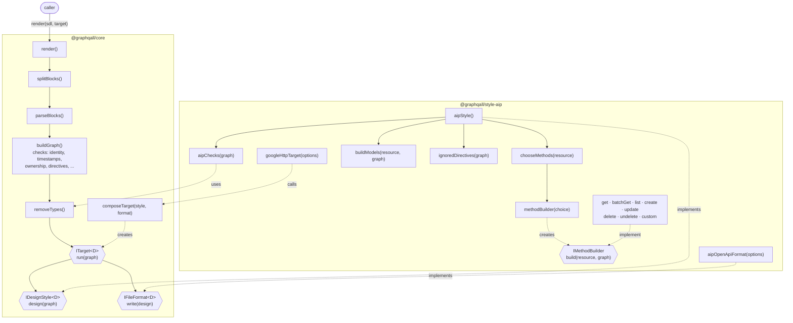

# Engine v0: technical design

Requirements: [requirements.md](requirements.md). Conventions: graphqall's `AGENTS.md`,
`docs/notation.md`, `docs/principles` (P-01, P-03, P-04, P-07) and `docs/standards/typescript`
(TS-01, TS-03, TS-04, TS-07).

## Part I: Design overview

### Approach

The engine is a chain of small steps. Each step takes the previous step's value and returns a new
value plus the problems it found. The steps are: split the SDL text into definition blocks, parse
each block, check the definitions and build the **resource graph**, then run a **target**. A target
is a design style followed by a file format. v0 ships one target, Google HTTP: the AIP design style
followed by the AIP OpenAPI format.

The resource graph is the engine's domain model. It holds resources, fields, ownership, references,
operations and custom methods as plain typed values, with no SDL syntax and no style in it. No step
after the graph reads SDL. Every graph node keeps its source: its SDL, printed without `#` comments,
and its location in the input. Problems point at that location, and a later GraphQL format can write
the SDL back out.

Parts that are chosen or swapped have a one-method interface and are created by a factory: the
design style, the file format and, inside the AIP style, one **method builder** per standard or
custom method. The AIP style asks a factory for the builders a resource needs, runs each one and
collects the methods. Each builder is tested alone against small hand-written resources, so method
behavior is proved once per builder and not again for every combination of resource settings. Checks
and calculations, such as "a resource has exactly one `ID!` field" or "turn `Book` into `books`",
are plain functions (TS-03 rule 3).

Every value is immutable: a step returns new values and never changes its input. Later values refer
back to earlier ones: design items refer to graph items, and graph items refer to the SDL.

Problems in the user's SDL are values; engine bugs throw to the caller. The engine catches
exceptions only where it translates a graphql-js syntax error into a problem (P-01 rule 3).

### Interface map



Hexagons are interfaces. Solid arrows pass a value to the next step; dotted arrows create, implement
or use. A caller's own format plugs in at `IFileFormat` through `composeTarget` (R4).

### Architectural changes

- **`@graphqall/core`** (existing, empty): the pipeline up to the resource graph, the problem types,
  the target interfaces, `composeTarget`, `removeTypes` and `render`. It ships the **prelude**, an
  SDL string that declares `DateTime`, `Date`, `LocalTime`, the notation's directives, and the enums
  their arguments use: `Off { NONE }`, `GetMode { NONE MANY }`, `DeleteMode { NONE SOFT }` and
  `Format { EMAIL URI UUID }`. These names are taken: a user type with one of them is a
  `duplicate_definition`.
- **`@graphqall/style-aip`** (new): the AIP design style, its checks, method builders and models,
  the AIP OpenAPI format and the `googleHttpTarget` shortcut. It imports only `@graphqall/core`, as
  the existing ESLint boundary rule requires.
- **Dependencies** (approved by the owner): `graphql` for the lexer, parser, printer and AST;
  `neverthrow` for `Result` (TS-01); `pluralize` and `@types/pluralize` for plurals (notation,
  Plurals); `openapi3-ts` for the OpenAPI 3.1 document types and builder (`openapi3-ts/oas31`), so
  the format writes no OpenAPI types of its own; and, for tests only, an OpenAPI 3.1 validator such
  as `@seriousme/openapi-schema-validator` (R10).

There is no registry of targets: a target is a value the caller builds and passes in.

### Contract changes

The public API is new, so nothing is incompatible. `render(sdl, target)` returns
`{ graph, design, files, problems }` (R1). The notation needs changes that require the owner's
approval: the problem-code list (R8). The other notation rules this design relies on (named
directive arguments, `@query` and `@mutation`, unsupported definitions, reserved names) are in the
notation.

### Decisions and tradeoffs

- **Text is split into blocks before parsing** so a syntax error stays inside one definition (R12).
  The split is a line-based rule (Part II); its limits are under Decisions needed.
- **Any error in a type removes the whole type and everything that depends on it** (R11). Warnings
  remove nothing. This is coarse but simple to state and to test. Core removes types with graph
  errors; the AIP style removes types with AIP errors (such as a name collision) using the same
  `removeTypes` function.
- **The engine checks SDL validity itself** (unknown types, undeclared directives, directive
  arguments, duplicate names). graphql-js's SDL validation entry point (`validateSDL`) is internal,
  and its public schema builder throws one combined error for all problems. Each check is a small
  function with its own problem code, which R8 and R9 need anyway.
- **Method builders receive their options when they are created**, from a tagged `MethodChoice`
  value, so every builder shares one interface even though methods take different options. A builder
  is a chosen part in TS-03 rule 3's sense: the factory picks which builders a resource gets, and a
  later style can supply its own set.
- **Three schemas per resource in OpenAPI** (read, create body, update body). One schema can't say
  that a `!` field is required on create but optional on update, or that a field is accepted on
  create but not on update.

## Part II: Detailed design

### Shared types (core)

```ts
type Span = {
  line: number;
  column: number;
  endLine: number;
  endColumn: number;
};
// 1-based lines and columns in the caller's SDL; the end is just after the last character.

type ProblemKind = "invalid_sdl" | "invalid_design";
type Problem<C extends ProblemCode = ProblemCode> = {
  kind: ProblemKind;
  code: C;
  severity: "error" | "warning";
  message: string;
  where: Span;
  path?: string; // such as 'Book.publisher'
};

type Outcome<T> = {
  value: T;
  problems: readonly Problem[];
};

type Source = {
  sdl: string;
  where: Span;
};
// sdl: the node printed with graphql's print(), which keeps descriptions and drops # comments
```

- `Outcome` is a step's return: a value that may be partial, plus every problem found. A pipeline
  step always succeeds with a value, so it is not a function with expected failures in TS-01 rule
  1's sense; the functions it calls are, and they return `Result`.
- Unit functions with expected failures return a neverthrow `Result`, typed with the codes they can
  return (TS-01 rules 1 and 4), for example
  `Result<IdField, Problem<'missing_id' | 'multiple_ids'>>`.
- A definition's independent checks are combined with neverthrow's `Result.combineWithAllErrors`, so
  every problem in a definition is reported, not only the first. A check that needs another's value
  follows it with `andThen`, which stops at the first error: a `@subset` selection that doesn't
  parse is not checked for unknown fields.
- A code's kind, severity and message are fixed by the code, in one table in core (notation,
  Problems). Tests never assert on messages (TS-07 rule 4). `syntax_error` is the one code whose
  message varies; see step 2.
- Types use `readonly` throughout.
- Data shapes are written with `type`. `interface` is used only for behavior: the `I`-prefixed
  contracts such as `IMethodBuilder`, `IFileFormat` and `ITarget`.

### Pipeline steps (core)

#### 1. `splitBlocks(sdl: string): Block[]`

`Block { text: string; start: { line: number; column: number }; keyword?: string; name?: string }`.

A new block starts at a line whose first token, outside a string or comment, is a definition keyword
(`type`, `interface`, `union`, `enum`, `input`, `scalar`, `directive`, `extend`, `schema`) followed
by a name, `@` or `{`. A field named `type` or `input` is followed by `:` or `(`, so it never starts
a block. A description string that starts a line, followed only by whitespace and comments before
such a keyword, belongs to that block. Text before the first block that holds only comments and
whitespace belongs to no block; if it holds any other token, it is an unnamed block. `keyword` and
`name` are read from the block's first tokens when present, so a block that later fails to parse
still has a known name.

String recovery, so an unfinished string doesn't swallow the rest of the input:

- A `"` string ends at its closing quote or at the end of its line.
- Inside a `"""` string, a line that would start a block (as above) does start one, and the
  unfinished string stays in the previous block, which then fails to parse.

This is a plain scanner over characters; it never fails.

#### 2. `parseBlocks(blocks): Outcome<ParsedBlock[]>`

Each block is parsed with `graphql`'s `parse`. graphql-js reports token and error positions relative
to the block's own text, so every position is mapped to the caller's SDL with one plain function:
`line = block.start.line + line - 1`, and on the block's first line
`column = block.start.column + column - 1`. A node's span runs from `loc.start` to `loc.end`, each
converted with graphql's `getLocation` and then mapped. Every `where` in the engine goes through
this mapping.

A `GraphQLError` from `parse` is caught and returned as `syntax_error`, located from the error's
first location to the end of that line, with `path` set to the block's name when it has one. When
nothing follows the error on its line, as at the end of a block (`<EOF>`), it is located at the
token before it, skipping comments, so it never points into the next definition. A token that
graphql-js can't lex, such as an unfinished string, runs to the block's last character that isn't
whitespace. Any other exception is rethrown (P-01 rule 3, TS-01 rule 3). The `syntax_error`
message is rewritten from a table in core keyed by graphql-js's syntax error forms:
`Expected <X>, found <Y>`, `Unterminated string`, `Unexpected character` and `Invalid number`. Any
other syntax error keeps graphql-js's description without its `Syntax Error:` prefix.

A block that fails to parse but has a `keyword` and `name` is kept as a **stub**: a named, empty
definition marked broken. A failed block with no name is dropped after its problem is reported.

#### 3. `buildGraph(parsed): Outcome<DraftGraph>`

Reads the prelude and the parsed definitions together, runs the checks in "Checks" (one plain
function per rule) and builds the graph types below. Every problem is attached to the definition it
was found in; a definition with at least one error is marked broken. The prelude is parsed once; no
problem can point into it.

Rules that involve other definitions:

- A reference to a stub is not checked further. It doesn't raise `unknown_type` or
  `owner_not_resource`; step 4 reports it as `depends_on_invalid_type`.
- With two definitions of one name, the second raises `duplicate_definition` and is broken;
  references resolve to the first.

Directive arguments are read from the AST. The notation's directives have their values checked
against the prelude's declared argument types. A declared foreign directive has its argument names,
required arguments and values checked against its declaration, and its values are also kept as
written (their SDL text) for a later GraphQL format (R7).

`DraftGraph` is a list of `Definition` entries:
`{ name; kind; broken: boolean; refs: readonly Ref[]; value?: GraphNode }`, where
`Ref { name; where: Span; path: string }` is one named use of another definition and `value` is the
built node, present only when the definition is not broken. Nodes refer to other definitions by
name, so a valid node can name a broken one until step 4 removes it.

#### 4. `removeTypes(definitions, broken): Outcome<readonly Definition[]>`

Removes the broken definitions, then repeatedly removes every definition that refers to a removed
one, until none is left (R11, R12). "Refers to" means any named use: a field type, an argument type,
a return type, an `@owner` field, or a foreign directive. Each removed dependent gets one
`depends_on_invalid_type` error, located at its first reference to a removed definition, with `path`
naming that field. Core calls it with the definitions broken in step 3 and builds the
`ResourceGraph` from the result with `toGraph(definitions)`. The AIP style calls it again with
`graphDefinitions(graph)`, a core function that lists a `ResourceGraph`'s definitions and
references, and the names its own checks break, then rebuilds the graph with `toGraph`.

#### 5. `target.run(graph)`, then `render`

```ts
interface IDesignStyle<D> {
  design(graph: ResourceGraph): Outcome<D>;
}
interface IFileFormat<D> {
  write(design: D): Outcome<readonly OutputFile[]>;
}
interface ITarget<D> {
  run(graph: ResourceGraph): Outcome<{ design: D; files: readonly OutputFile[] }>;
}
type OutputFile = {
  path: string;
  content: string;
};

function composeTarget<D>(style: IDesignStyle<D>, format: IFileFormat<D>): ITarget<D>;
function render<D>(sdl: string, target: ITarget<D>): RenderResult<D>;
type RenderResult<D> = {
  graph: ResourceGraph;
  design: D;
  files: readonly OutputFile[];
  problems: readonly Problem[]; // every step's, ordered by where
};
```

`composeTarget` runs the style, passes its design to the format and concatenates both steps'
problems. `render` runs steps 1 to 5 and always returns all four parts; with no valid resource, the
graph and design are empty (R1). A caller adds a format by implementing `IFileFormat<AipDesign>` and
calling `composeTarget(aipStyle(), theirFormat)` (R4).

### The resource graph (core)

```ts
type ResourceGraph = {
  resources: readonly Resource[];
  objects: readonly ObjectType[]; // value types: object types without @resource
  inputs: readonly InputType[]; // input types, used as custom method arguments
  enums: readonly EnumType[];
  directives: readonly DirectiveDeclaration[]; // declared foreign directives
};

type Resource = {
  name: string; // 'Book'
  plural: string; // 'books' (lowerCamelCase); from @resource(plural) or pluralize
  // a @resource(plural) value must be a GraphQL name ([A-Za-z_][A-Za-z0-9_]*), else
  // invalid_directive_argument
  description?: string;
  id: Field; // the one ID! field
  created: Field;
  updated?: Field; // absent only when update is off and no field is marked
  deleted?: Field; // present exactly when delete is SOFT
  owner?: { field: Field; resource: string };
  fields: readonly Field[]; // every data field in declaration order, including the above
  customMethods: readonly CustomMethod[];
  operations: Operations;
  directives: readonly AppliedDirective[];
  source: Source;
};

type Operations = {
  get: "ON" | "NONE" | "MANY";
  list: boolean;
  create: boolean;
  update: boolean;
  delete: "ON" | "NONE" | "SOFT";
};

type Field = {
  name: string;
  description?: string;
  type: TypeRef;
  role: "id" | "created" | "updated" | "deleted" | "owner" | "data";
  input: { create: boolean; update: boolean };
  validation: Validation;
  filterBy: boolean;
  sortBy: boolean;
  subset?: Selection; // kept for the REST style
  expandable: boolean; // kept for the REST style
  number?: number; // kept for the gRPC style
  directives: readonly AppliedDirective[];
  source: Source;
};

type TypeRef = {
  name: string;
  // "unknown": a definition that failed to parse; step 4 removes every node that uses one.
  kind: "scalar" | "enum" | "object" | "input" | "resource" | "unknown";
  nonNull: boolean;
  list?: { itemNonNull: boolean };
};

type Validation = {
  length?: { min?: number; max?: number };
  range?: { min?: number; max?: number };
  pattern?: string;
  format?: "EMAIL" | "URI" | "UUID";
};

type CustomMethod = {
  name: string; // 'archive'
  description?: string;
  target: "item" | "collection"; // item when it has an ID! argument; the first one is the item
  kind: "query" | "mutation"; // from @query or @mutation
  args: readonly Argument[]; // as written, including the item's ID! argument
  returns: TypeRef;
  directives: readonly AppliedDirective[];
  source: Source;
};

type Argument = {
  name: string;
  description?: string;
  type: TypeRef;
  validation: Validation;
  directives: readonly AppliedDirective[];
  source: Source;
};

type AppliedDirective = {
  name: string;
  args: Readonly<Record<string, string>>;
  source: Source;
};
// args hold each value's SDL text, e.g. { role: '"admin"' }
```

- `input` is `{ create: false, update: false }` for the `id`, `created`, `updated`, `deleted` and
  `owner` roles. For `data` fields it comes from `@input`.
- `ObjectType` and `InputType` have `name`, `description`, `fields` (with the `Field` members that
  apply to a value: name, description, type, validation, directives, source), `directives` and
  `source`. `EnumType` has `name`, `description`, `values` (each with `name`, `description`,
  `directives` and `source`), `directives` and `source`. `DirectiveDeclaration` has `name`,
  `description`, its arguments, locations, `repeatable` and `source`. `Selection` is the parsed
  `@subset` selection: field names, with nested selections for value-object fields.
- Every node that SDL lets a directive appear on carries `directives`, so foreign directives stay in
  the graph wherever they were written (R7).
- `#` comments are not in the AST, and `Source.sdl` is printed from the AST, so no comment reaches
  the graph or any output (R9).

### Checks (core)

Each rule below is one function over one definition or field. An error marks the definition broken.

- **SDL validity:** duplicate definition names; duplicate field names in a type, argument names in a
  field or directive declaration, and enum values; the same argument twice in one directive use; an
  object or resource type used as an argument or input field type, and an input type used as a field
  type of an object or resource; unknown type names; undeclared directives; a directive at a
  location its declaration doesn't allow; a non-repeatable directive used twice; unknown, missing or
  wrongly typed directive arguments; definitions the notation doesn't support (`interface`, `union`,
  a user-declared `scalar`, `extend`, `schema`, and `implements` on a type).
- **Identity:** exactly one `ID!` field on a resource.
- **Timestamps:** exactly one `@created` and one `@updated`, each `DateTime!`; `@updated` optional
  when `update: NONE`; with `delete: SOFT`, exactly one `@deleted` of type `DateTime`; `@deleted`
  without `delete: SOFT`.
- **Ownership:** at most one `@owner`; the owner's type is a non-null resource, not a list; no
  loops; a chain deeper than 3 levels is a warning on each resource below the third level.
- **Field directives:** `@length` only on `String` or lists, `@range` only on `Int` or `Float`,
  `@pattern` and `@format` only on `String`, `min` not greater than `max`; `@created`, `@updated`,
  `@deleted`, `@owner`, `@input`, `@filterBy`, `@sortBy`, `@subset`, `@expandable`, `@number`,
  `@query` and `@mutation` only on fields of a resource.
- **References:** `@subset` and `@expandable` only on a reference; a `@subset` selection parses,
  names only fields of the target, includes its `ID!` field and contains no resource field. The
  selection is parsed with graphql's `parse` as `{ … }`; its `GraphQLError` is caught and returned
  as `subset_syntax_error`, the second targeted catch TS-01 rule 3 allows.
- **Custom methods:** a field with arguments must be marked `@query` or `@mutation`, not both. The
  first `ID!` argument makes it an item method; any other `ID!` argument is an ordinary argument.
  The arguments of a `@query` are scalars, enums, lists of them, or input types whose fields are all
  scalars, enums or lists of them, so they map to query parameters.

A `!` field with `@input(create: NONE)` is valid: it is required in reads and absent from the create
body.

### Problem codes

Every code below goes into the notation's Problems section with the owner's approval (R8). The
`where` span is the node named in the last column.

| Code                            | Kind           | Severity | Located at                                                |
| ------------------------------- | -------------- | -------- | --------------------------------------------------------- |
| `syntax_error`                  | invalid_sdl    | error    | the error position to the end of its line                 |
| `duplicate_definition`          | invalid_sdl    | error    | the second definition's name                              |
| `unsupported_definition`        | invalid_sdl    | error    | the definition's keyword and name                         |
| `duplicate_field`               | invalid_sdl    | error    | the second field                                          |
| `duplicate_argument`            | invalid_sdl    | error    | the second argument                                       |
| `duplicate_enum_value`          | invalid_sdl    | error    | the second value                                          |
| `wrong_type_position`           | invalid_sdl    | error    | the type name where it is used                            |
| `query_argument_nested`         | invalid_design | error    | the argument                                              |
| `query_and_mutation`            | invalid_sdl    | error    | the second directive use                                  |
| `unknown_type`                  | invalid_sdl    | error    | the type name where it is used                            |
| `nested_list`                   | invalid_sdl    | error    | the inner list type                                       |
| `undeclared_directive`          | invalid_sdl    | error    | the directive use                                         |
| `directive_wrong_location`      | invalid_sdl    | error    | the directive use                                         |
| `directive_repeated`            | invalid_sdl    | error    | the second use                                            |
| `unknown_directive_argument`    | invalid_sdl    | error    | the argument                                              |
| `missing_directive_argument`    | invalid_sdl    | error    | the directive use                                         |
| `invalid_directive_argument`    | invalid_sdl    | error    | the argument value                                        |
| `validation_wrong_type`         | invalid_sdl    | error    | the directive use                                         |
| `min_greater_than_max`          | invalid_sdl    | error    | the directive use                                         |
| `directive_outside_resource`    | invalid_sdl    | error    | the directive use                                         |
| `arguments_without_method_kind` | invalid_sdl    | error    | the field                                                 |
| `subset_not_reference`          | invalid_sdl    | error    | the directive use                                         |
| `expandable_not_reference`      | invalid_sdl    | error    | the directive use                                         |
| `subset_syntax_error`           | invalid_sdl    | error    | the selection string                                      |
| `subset_unknown_field`          | invalid_design | error    | the selection string                                      |
| `subset_missing_id`             | invalid_design | error    | the selection string                                      |
| `subset_contains_resource`      | invalid_design | error    | the selection string                                      |
| `missing_id`                    | invalid_design | error    | the type name                                             |
| `multiple_ids`                  | invalid_design | error    | the second `ID!` field                                    |
| `missing_created`               | invalid_design | error    | the type name                                             |
| `multiple_created`              | invalid_design | error    | the second marked field                                   |
| `missing_updated`               | invalid_design | error    | the type name                                             |
| `multiple_updated`              | invalid_design | error    | the second marked field                                   |
| `missing_deleted`               | invalid_design | error    | the type name                                             |
| `multiple_deleted`              | invalid_design | error    | the second marked field                                   |
| `deleted_without_soft_delete`   | invalid_design | error    | the `@deleted` use                                        |
| `timestamp_wrong_type`          | invalid_design | error    | the field's type                                          |
| `multiple_owners`               | invalid_design | error    | the second `@owner` field                                 |
| `owner_not_resource`            | invalid_design | error    | the field's type                                          |
| `ownership_loop`                | invalid_design | error    | the `@owner` field of each type in the loop               |
| `ownership_too_deep`            | invalid_design | warning  | the `@owner` field of each resource below the third level |
| `depends_on_invalid_type`       | invalid_design | error    | the first reference to the removed type                   |
| `field_name_reserved`           | invalid_design | error    | the field (AIP style)                                     |
| `model_name_taken`              | invalid_design | error    | the user type's name (AIP style)                          |
| `method_name_taken`             | invalid_design | error    | the custom method (AIP style)                             |
| `path_taken`                    | invalid_design | error    | the second resource's type name (AIP style)               |
| `directive_ignored`             | invalid_design | warning  | the directive use (AIP style)                             |

The last five are raised by the AIP style, not core: see "AIP checks".

### AIP design style (`@graphqall/style-aip`)

```ts
function aipStyle(): IDesignStyle<AipDesign>;

type AipDesign = {
  resources: readonly AipResource[]; // endpoints grouped by resource
  models: readonly Model[]; // every request and response model
  deviations: readonly Deviation[];
};
type AipResource = {
  name: string;
  pattern: string;
  methods: readonly AipMethod[];
  from: Resource;
};
// pattern: 'publishers/{publisher}/books/{book}'

type AipMethod = {
  name: string; // 'GetBook', 'ListBooks', 'ArchiveBook'
  verb: "GET" | "POST" | "PATCH" | "DELETE";
  path: string; // '/v1/publishers/{publisher}/books/{book}:archive'
  pathParams: readonly string[];
  query: readonly Param[];
  body?: string; // model name
  response: { model: string } | { type: TypeRef }; // a model, or a custom method's return as written
  description?: string;
  from: Resource | CustomMethod; // the graph item it was built from
};

type Param = {
  name: string;
  schema: TypeRef;
  repeated: boolean;
  description?: string;
};

type Model = {
  name: string;
  description?: string;
  fields: readonly ModelField[]; // each ModelField keeps `from: Field | Argument`
  from: Resource | ObjectType | InputType | EnumType | CustomMethod | "builtin";
};
```

Design values are AIP's own types, not graph or SDL types. Each one keeps the graph item it was
built from (`from`), so any endpoint or model can be traced through that item's `source` to the SDL
that produced it.

`deviations` is empty in v0. The notation defines a deviation as an override of a style convention,
and overrides are deferred; turning an operation off is not a deviation.

`aipStyle().design(graph)` runs, in order: the AIP checks, `removeTypes` with the types those checks
broke, `ignoredDirectives`, then for each remaining resource `chooseMethods`, the builders and
`buildModels`.

#### AIP checks

Plain functions over the graph:

- **`field_name_reserved`**: a resource field other than the ID field is named `name`, which AIP
  uses for the resource name. The resource is broken.
- **`model_name_taken`**: a user type has the same name as a generated model (see Models), such as a
  value type named `Status` or `TimeOfDay`. The user type is broken.
- **`method_name_taken`**: a custom method's generated name, or its body model's name, equals any
  other method or model name in the design: a custom method `get` on `Book` (`GetBook`), or
  `createBook` on `Shelf` (`CreateBookShelf`) beside a resource `BookShelf`. The resource with the
  custom method is broken.
- **`path_taken`**: two resources have the same collection path, meaning the pattern with parameter
  names ignored (the owner chain's collections plus the resource's plural), such as two resources
  with the same plural and owner. The second, in source order, is broken.
- **`ignoredDirectives`**: one `directive_ignored` warning for each `@subset`, `@expandable`,
  `@number` and foreign directive anywhere in the graph (R6, R7). The design is the same with or
  without them.

#### Choosing and building methods

```ts
type MethodChoice =
  | { kind: "get" }
  | { kind: "batchGet" }
  | {
      kind: "list";
      showDeleted: boolean;
      filterFields: readonly string[];
      sortFields: readonly string[];
    }
  | { kind: "create" }
  | { kind: "update" }
  | { kind: "delete"; soft: boolean }
  | { kind: "undelete" }
  | { kind: "custom"; method: CustomMethod };

function chooseMethods(resource: Resource): readonly MethodChoice[];
function methodBuilder(choice: MethodChoice): IMethodBuilder;
interface IMethodBuilder {
  build(resource: Resource, graph: ResourceGraph): AipMethod;
}
```

`chooseMethods` reads `Resource.operations` and the fields:

- `get: ON` gives `get`; `MANY` gives `get` and `batchGet`.
- `list` gives `list`, with `showDeleted` when delete is `SOFT`, and the names of the `@filterBy`
  and `@sortBy` fields.
- `delete: ON` gives `delete`; `SOFT` gives `delete(soft)` and `undelete`.
- `create` and `update` give themselves; each custom method gives `custom`.
- Off operations give nothing.

`methodBuilder` returns one builder per kind; a builder exposes only `build` (TS-03 rule 2). The
style collects each resource's methods in the order get, batchGet, list, create, update, delete,
undelete, then custom methods as written.

Building can't fail: every input it reads has been checked. A builder that meets an impossible input
throws, as an engine bug would.

#### Paths and names

The resource pattern joins each owner's collection and parameter down the chain:
`publishers/{publisher}/books/{book}`. The collection is `Resource.plural`; the parameter is the
resource name in lowerCamelCase. Every path starts with `/v1/` (R3). `{parent}` below is the owner's
pattern; a resource with no owner has none (`/v1/books`).

| Choice             | Verb and path                                           | Name            | Request                                                                           | Response                                       |
| ------------------ | ------------------------------------------------------- | --------------- | --------------------------------------------------------------------------------- | ---------------------------------------------- |
| get                | `GET /v1/{pattern}`                                     | `GetBook`       | path only                                                                         | `Book`                                         |
| batchGet           | `GET /v1/{parent}/books:batchGet`                       | `BatchGetBooks` | query `names` (repeated)                                                          | `BatchGetBooksResponse` `{ books }`            |
| list               | `GET /v1/{parent}/books`                                | `ListBooks`     | query `pageSize`, `pageToken`, and `filter`, `orderBy`, `showDeleted` when chosen | `ListBooksResponse` `{ books, nextPageToken }` |
| create             | `POST /v1/{parent}/books`                               | `CreateBook`    | body `CreateBookBody`                                                             | `Book`                                         |
| update             | `PATCH /v1/{pattern}`                                   | `UpdateBook`    | query `updateMask`, body `UpdateBookBody`                                         | `Book`                                         |
| delete             | `DELETE /v1/{pattern}`                                  | `DeleteBook`    | path only                                                                         | `Empty`, or `Book` when soft                   |
| undelete           | `POST /v1/{pattern}:undelete`                           | `UndeleteBook`  | body `Empty`                                                                      | `Book`                                         |
| custom, item       | `POST /v1/{pattern}:archive` (`GET` for a `@query`)     | `ArchiveBook`   | body `ArchiveBookBody`, or query parameters for a `@query`                        | the return type                                |
| custom, collection | `POST /v1/{parent}/books:search` (`GET` for a `@query`) | `SearchBooks`   | body `SearchBooksBody`, or query parameters for a `@query`                        | the return type                                |

- A custom method's name is its own name in UpperCamelCase followed by the resource name: singular
  (`Book`) on an item, the plural in UpperCamelCase (`Books`) on the collection. A `@mutation` has a
  body model named the method name plus `Body`, holding every argument except the item's `ID!`
  argument, in the order written. A `@query` has no body model.
- A custom method that returns a resource responds with the resource's read model (`$ref` `Book`),
  or an array of them for a list.
- A `@query` uses `GET` and sends the same arguments as query parameters, under Google's HTTP
  mapping: a list argument is a repeated parameter, and an object or input argument is flattened
  into dotted names (`query.text`).
- A custom method gets nothing the SDL doesn't write: no paging, wrappers or extra arguments
  (notation, Custom methods).

#### Models

For each resource, `buildModels` makes:

- **`Book`** (read): every field. The ID field is named `name` and holds the resource name. Fields
  with both `input` flags false (server-set fields, the owner, and fields with
  `@input(create: NONE, update: NONE)`) are read-only. `!` fields are required.
- **`CreateBookBody`**: fields with `input.create`. `!` fields are required.
- **`UpdateBookBody`**: fields with `input.update`, with nothing required.

No schema allows `null`: a field without `!` is simply not required, and an unset field is left out
(proto3 JSON). In the update body, a field is cleared by naming it in `updateMask` and leaving it
out.

Value object types, input types and enums become models under their own names. A reference is a
resource-name string (`"authors/7"`); a list of references is an array of them. Validation applies
wherever the field or argument appears.

The generated model names are: for each resource, `<Name>`, `Create<Name>Body`, `Update<Name>Body`,
`List<Plural>Response`, `BatchGet<Plural>Response` and each body model of a custom method; and the
built-in `Empty`, `Status`, `Date` and `TimeOfDay`. A user type with one of these names raises
`model_name_taken`.

### AIP OpenAPI format

```ts
function aipOpenApiFormat(options: { title: string; version: string }): IFileFormat<AipDesign>;
function googleHttpTarget(options: { title: string; version: string }): ITarget<AipDesign>;
// composeTarget(aipStyle(), aipOpenApiFormat(options))
```

It writes one file, `openapi.json`: OpenAPI 3.1, JSON with two-space indentation. It reads only the
design. Each resource is a tag; each method is an operation with `operationId` equal to the method
name; each model is a schema under `components.schemas`. Every operation has a `default` response of
`Status` (`{ code: integer, message: string, details: object[] }`, google.rpc.Status).

| Graph type           | JSON Schema                                                                                 |
| -------------------- | ------------------------------------------------------------------------------------------- |
| `String`, `ID`       | `string`                                                                                    |
| `Int`                | `integer`, format `int32`                                                                   |
| `Float`              | `number`, format `double`                                                                   |
| `Boolean`            | `boolean`                                                                                   |
| `DateTime`           | `string`, format `date-time`                                                                |
| `Date`               | `$ref` `Date`: `{ year, month, day }`, integers                                             |
| `LocalTime`          | `$ref` `TimeOfDay`: `{ hours, minutes, seconds, nanos }`, integers                          |
| enum                 | `string` with `enum`; when any value has a description, `oneOf` of `{ const, description }` |
| object or input type | `$ref` to its model                                                                         |
| list                 | `array`                                                                                     |
| `@length`            | `minLength`/`maxLength`, or `minItems`/`maxItems` on a list                                 |
| `@range`             | `minimum`/`maximum`                                                                         |
| `@pattern`           | `pattern`                                                                                   |
| `@format`            | `format` `email`, `uri`, `uuid`                                                             |
| description          | `description` on the schema, property or parameter                                          |

- `updateMask` is a `string` query parameter (a comma-separated field mask in proto3 JSON).
- The `filter` parameter's description lists the fields that can be filtered, and `orderBy`'s the
  fields that can be sorted, so the per-field settings are visible in the file.

### Runtime boundary (R2)

- Each package has two TypeScript configs: one for `src`, with `lib: ["ES2022"]` and `types: []`, so
  a Node or DOM API fails type checking; and one for `tests`, with Node types. This overrides
  `types: ["node"]` from `tsconfig.base.json` for `src`.
- ESLint forbids `node:` imports under `packages/*/src`. In flat config a later block's options for
  the same rule replace earlier ones, and the existing core and style blocks also match tests. So
  each existing `no-restricted-imports` block is split into a `src` block (boundary patterns plus
  `node:*`) and a block for everything else (boundary patterns only).
- The prelude is a string constant, not a file.

### Testing

Tests follow P-07 and TS-07. They are written, or reviewed, by an agent that has not read the
implementation, working from the notation, the requirements and this spec (P-07 rule 2). No test
asserts a message. `@graphqall/style-aip` gets the same `expect.hasAssertions()` setup as core
(TS-07 rule 1).

- **Core rules:** one `it.each` table per rule. Each row is a small SDL snippet and the exact
  problems expected: kind, code, severity, `where` and `path`. Each table also has rows that pass.
  Together they cover every core problem code (R9).
- **Spans:** problems in the second and later blocks, and on a block's first line after an indent,
  are located in the caller's SDL.
- **Graph:** for each directive and argument, a snippet and the hand-written graph value expected.
- **Splitting and partial results:** the acceptance cases of R11 and R12, a field named `type`, a
  description before a definition, and an unterminated `"` and `"""` string followed by a valid
  definition.
- **AIP checks:** one table per check, covering `field_name_reserved`, `model_name_taken`,
  `method_name_taken`, `path_taken` and `directive_ignored`, with the exact problems and the
  resources left in the design.
- **Method builders:** each builder alone, with a resource built by a test factory, asserting the
  whole `AipMethod`. `chooseMethods` gets its own table: every `@resource` argument and value maps
  to the expected choices.
- **Models and format:** each mapping row above, as a unit test of the model and schema functions.
- **End to end:** each `examples/<case>/` holds `schema.graphql` and a hand-written `openapi.json`.
  The test renders the SDL, parses the output, compares it with the expected file using `toEqual`
  (key order ignored) and runs the OpenAPI 3.1 validator (R10). The cases cover the parts of R9's
  list that cross the whole pipeline: descriptions present, the three time types, references, an
  ownership chain, and the notation's own example. One case puts distinctive `#` comment text in the
  SDL and asserts it appears nowhere in the `RenderResult`, graph included.
- **R4:** a test that imports only the packages' public entry points composes `aipStyle()` with a
  stub format and asserts it receives the design and that its files are returned.

## Decisions needed

None. The limits of block splitting (R12) are accepted: a syntax error stays inside its definition
only when the next definition starts on its own line, so two definitions on one line form one block,
and a `"""` description containing a line that looks like a definition is split there. An enum value
spelled like a lowercase keyword (`type`, `input`, `scalar`) on its own line and followed by a name
or `@` also starts a block.
